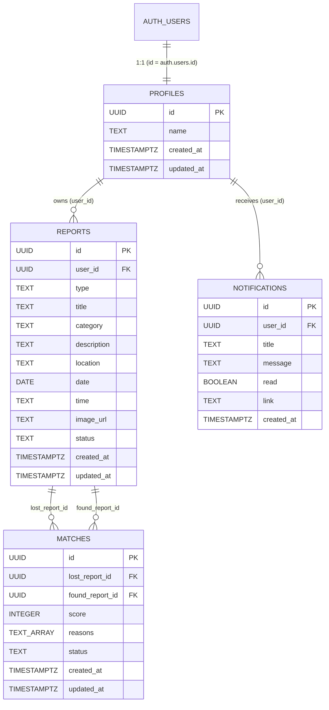

# LostLink — Database Schema, Security Architecture & Migration Guide

This document accompanies [`supabase/migrations/20261012163500_initial_schema.sql`](file:///d:/field%20project/supabase/migrations/20261012163500_initial_schema.sql). It details the database design, security invariants, foreign key cascade justifications, image storage strategy, deployment instructions, and test scenarios.

---

## 1. Schema & Relationships



---

## 2. Table Definitions & Constraints

### 1. `public.profiles`
- **Primary Key**: `id UUID PRIMARY KEY REFERENCES auth.users(id) ON DELETE CASCADE`.
- **Public Visibility**: Contains only non-sensitive display data (`name`, `created_at`, `updated_at`). Private student identity (email, password hash, session tokens) is never copied into public tables.
- **Trigger-Based Creation**: Populated via `public.handle_new_user()` when a new row is created in `auth.users`.
- **Fail-Safe Design**: Wrapped in an exception handler (`EXCEPTION WHEN OTHERS THEN RAISE WARNING ...`) so that any unexpected profile write failure emits a warning in server logs rather than aborting the student's authentication signup transaction.
- **Self-Repair Procedure**: `public.ensure_profile_exists()` allows an authenticated user to idempotently create or repair their profile if the trigger was bypassed or for existing accounts.

### 2. `public.reports`
- **Columns**:
  - `id UUID PRIMARY KEY DEFAULT gen_random_uuid()`
  - `user_id UUID NOT NULL REFERENCES public.profiles(id) ON DELETE CASCADE`
  - `type TEXT NOT NULL CHECK (type IN ('lost', 'found'))`
  - `title TEXT NOT NULL`
  - `category TEXT NOT NULL CHECK (category IN ('Electronics', 'ID Cards', 'Bags', 'Books', 'Accessories', 'Keys', 'Other'))`
  - `description TEXT NOT NULL`
  - `location TEXT NOT NULL`
  - `date DATE NOT NULL`
  - `time TEXT`
  - `image_url TEXT`
  - `status TEXT NOT NULL DEFAULT 'lost' CHECK (status IN ('lost', 'found', 'resolved'))`
  - `created_at TIMESTAMPTZ NOT NULL DEFAULT now()`
  - `updated_at TIMESTAMPTZ NOT NULL DEFAULT now()`
- **Status & Type Coherence Constraint**:
  ```sql
  CONSTRAINT check_report_status_matches_type CHECK (
    (type = 'lost' AND status IN ('lost', 'resolved')) OR
    (type = 'found' AND status IN ('found', 'resolved'))
  )
  ```
  Prevents corrupt states such as a `found` item marked as `lost`.
- **Integrity Trigger (`handle_report_update`)**:
  - If `OLD.status = 'resolved'`, **completely locks the report**: no content edits, no title/description changes, and no reopening are permitted.
  - Prevents changing `type` after creation.
  - Prevents transferring `user_id` to another student.
  - Automatically updates `updated_at = now()`.
- **Resolution Trigger (`handle_report_resolved`)**:
  - When an owner marks a report as `resolved`, this `SECURITY DEFINER` trigger immediately marks all pending candidate matches involving the report as `rejected`. This guarantees resolution integrity even if the status update is submitted directly through the PostgREST API.
- **Authorized Procedure (`resolve_report`)**:
  - Secure RPC endpoint `public.resolve_report(report_id UUID)` verifying `auth.uid() = user_id` and locking the report status to `'resolved'`.

### 3. `public.matches`
- **Columns**:
  - `id UUID PRIMARY KEY DEFAULT gen_random_uuid()`
  - `lost_report_id UUID NOT NULL REFERENCES public.reports(id) ON DELETE CASCADE`
  - `found_report_id UUID NOT NULL REFERENCES public.reports(id) ON DELETE CASCADE`
  - `score INTEGER NOT NULL CHECK (score >= 0 AND score <= 100)`
  - `reasons TEXT[] NOT NULL DEFAULT '{}'`
  - `status TEXT NOT NULL DEFAULT 'pending' CHECK (status IN ('pending', 'verified', 'rejected'))`
  - `created_at TIMESTAMPTZ NOT NULL DEFAULT now()`
  - `updated_at TIMESTAMPTZ NOT NULL DEFAULT now()`
- **Integrity Constraints**:
  - `CONSTRAINT check_different_reports CHECK (lost_report_id != found_report_id)`: Prevents an item from matching against itself.
  - `CONSTRAINT unique_match_pair UNIQUE (lost_report_id, found_report_id)`: Prevents duplicate match entries between the same lost and found items.

### 4. `public.notifications`
- **Columns**:
  - `id UUID PRIMARY KEY DEFAULT gen_random_uuid()`
  - `user_id UUID NOT NULL REFERENCES public.profiles(id) ON DELETE CASCADE`
  - `title TEXT NOT NULL`
  - `message TEXT NOT NULL`
  - `read BOOLEAN NOT NULL DEFAULT false`
  - `link TEXT`
  - `created_at TIMESTAMPTZ NOT NULL DEFAULT now()`
- **Indexes**:
  - `idx_notifications_user_inbox ON (user_id, created_at DESC)` for instantaneous reverse-chronological inbox queries.
  - `idx_notifications_user_read ON (user_id, read)` for unread badge counters.

---

## 3. Foreign Key Deletion Rules Justification

| Relationship | Foreign Key Constraint | Deletion Rule | Justification |
| :--- | :--- | :--- | :--- |
| `profiles.id -> auth.users.id` | `REFERENCES auth.users(id)` | **`ON DELETE CASCADE`** | If a student's authentication record is deleted (e.g. account deletion or GDPR request), their public profile row has no reason to exist. |
| `reports.user_id -> profiles.id` | `REFERENCES public.profiles(id)` | **`ON DELETE CASCADE`** | A report cannot exist without an owner. Deleting a profile cleans up all reports authored by that user. |
| `notifications.user_id -> profiles.id` | `REFERENCES public.profiles(id)` | **`ON DELETE CASCADE`** | Notifications are private inbox records. Deleting a user cleans up all their associated alerts. |
| `matches.lost_report_id -> reports.id` | `REFERENCES public.reports(id)` | **`ON DELETE CASCADE`** | A candidate match represents a pairing between two specific physical reports. If either report is deleted, the candidate match pair is invalid. `NOT NULL` prevents orphaned matches; deleting the match matches the Phase 1.4 `deleteReport` behavior. |
| `matches.found_report_id -> reports.id` | `REFERENCES public.reports(id)` | **`ON DELETE CASCADE`** | Same justification as `lost_report_id`. |

---

## 4. Row-Level Security (RLS) Policy Audit

| Table | Policy Name | Command | Audience | Condition | Security Objective |
| :--- | :--- | :--- | :--- | :--- | :--- |
| **`profiles`** | `Profiles are readable by authenticated users` | `SELECT` | `authenticated` | `true` | Allows students to see the display name of item reporters on cards/detail pages. |
| **`profiles`** | `Users can insert their own profile` | `INSERT` | `authenticated` | `auth.uid() = id` | Fallback policy allowing a user to initialize their profile if the trigger was bypassed. |
| **`profiles`** | `Users can update their own profile` | `UPDATE` | `authenticated` | `auth.uid() = id` | Prevents students from tampering with other students' names. |
| **`reports`** | `Reports are readable by authenticated users` | `SELECT` | `authenticated` | `true` | Allows authenticated campus students to browse all active lost and found reports. |
| **`reports`** | `Users can create their own reports` | `INSERT` | `authenticated` | `auth.uid() = user_id` | Enforces that any submitted report is attributed strictly to the submitting user. |
| **`reports`** | `Users can update their own reports` | `UPDATE` | `authenticated` | `auth.uid() = user_id` | Allows owners to update active reports while preventing transfer of ownership. |
| **`reports`** | `Users can delete their own reports` | `DELETE` | `authenticated` | `auth.uid() = user_id` | Ensures only the item owner can delete a report. |
| **`matches`** | `Users can view matches involving their reports` | `SELECT` | `authenticated` | `EXISTS (... user_id = auth.uid())` | Users only see potential matches that reference an item they own (`lost` or `found`). |
| **`notifications`** | `Users can view their own notifications` | `SELECT` | `authenticated` | `auth.uid() = user_id` | Keeps notification messages strictly private to the intended recipient. |
| **`notifications`** | `Users can update their own notifications` | `UPDATE` | `authenticated` | `auth.uid() = user_id` | Allows users to toggle `read: true` on their own notifications. |
| **`notifications`** | `Users can delete their own notifications` | `DELETE` | `authenticated` | `auth.uid() = user_id` | Allows users to clear items from their inbox. |

### Withheld Client Writes
- **`public.matches` (INSERT, UPDATE, DELETE)**: Direct client mutation policies are deliberately omitted. PostgreSQL defaults to **DENY ALL**. Match calculation and status transitions must be executed via trusted backend triggers or Edge Functions.
- **`public.notifications` (INSERT)**: Direct client insertion is deliberately omitted. Users cannot inject arbitrary notifications into other users' inboxes.

---

## 5. Trigger Security & Least Privilege

1. **`handle_new_user()`**:
   - `SECURITY DEFINER` with fixed `search_path = public`.
   - Execution is **`REVOKE EXECUTE ... FROM PUBLIC`** so arbitrary users cannot trigger profile insertions directly.
2. **`handle_report_update()`**:
   - Execution is **`REVOKE EXECUTE ... FROM PUBLIC`**.
3. **`handle_report_resolved()`**:
   - `SECURITY DEFINER` with fixed `search_path = public` to permit updating `public.matches` when resolving reports, even though client RLS denies direct writes to `matches`.
   - Execution is **`REVOKE EXECUTE ... FROM PUBLIC`**.
4. **`resolve_report(report_id UUID)`**:
   - `SECURITY DEFINER` with fixed `search_path = public`.
   - Validates `user_id = auth.uid()`.
   - Execution is granted to `authenticated` only (`REVOKE ... FROM PUBLIC; GRANT ... TO authenticated`).
5. **`ensure_profile_exists()`**:
   - `SECURITY DEFINER` with fixed `search_path = public`.
   - Validates `auth.uid() IS NOT NULL` and creates profile for `auth.uid()`.
   - Execution is granted to `authenticated` only (`REVOKE ... FROM PUBLIC; GRANT ... TO authenticated`).

---

## 6. Image Storage Architecture (`report-images`)

### Security Consideration
Reports in LostLink frequently contain pictures of **Student ID Cards**, driver's licenses, keys, and personal belongings.
- Creating a public bucket (`public = true`) would expose student photographs, university IDs, and full names to unauthenticated web crawlers and direct link enumeration.

### Storage Bucket Specification
1. **Bucket Configuration**:
   - Bucket ID: `report-images`
   - Access: `public = false` (Private bucket)
2. **Access Policies on `storage.objects`**:
   - **Upload**: `auth.uid() = (storage.foldername(name))[1]::uuid` restricts upload folders to the user's UUID (`<user_id>/<report_id>-<file>`).
   - **Download / View**: Authorized authenticated campus students retrieve short-lived signed URLs (`createSignedUrl(path, 3600)`) or authenticated downloads via the Supabase client.
   - **Delete**: Only the folder owner (`auth.uid() = (storage.foldername(name))[1]::uuid`) can delete stored images.

---

## 7. Migration Application Instructions

### Option A: Fresh Database Installation
1. Log in to your [Supabase Project Dashboard](https://supabase.com/dashboard).
2. In the left navigation, click **SQL Editor**.
3. Click **New Query**, paste the complete contents of [`supabase/migrations/20261012163500_initial_schema.sql`](file:///d:/field%20project/supabase/migrations/20261012163500_initial_schema.sql), and click **Run**.
4. Verify execution completes with: `Success. No rows returned`.

### Option B: Upgrade on Existing Draft Schema
- The migration script is written defensively with:
  - `CREATE TABLE IF NOT EXISTS`
  - `DO $$ ... ADD CONSTRAINT IF NOT EXISTS ... $$;`
  - `CREATE OR REPLACE FUNCTION`
  - `DROP TRIGGER IF EXISTS ... CREATE TRIGGER ...`
  - `DROP POLICY IF EXISTS ... CREATE POLICY ...`
- If you ran an earlier draft of this migration, rerunning the script will safely add the missing triggers, constraints (`check_report_status_matches_type`, `unique_match_pair`), and procedures without throwing duplicate errors.

---

## 8. Comprehensive SQL Verification Test Cases

To verify that all RLS policies, trigger constraints, and security barriers function correctly, execute the following test suite in the Supabase SQL Editor.

> [!NOTE]
> The SQL Editor executes queries as the database superuser (`postgres`), which bypasses RLS by default.
> To test RLS in the SQL Editor, we simulate roles and user JWT claims using `SET LOCAL ROLE authenticated; SET LOCAL "request.jwt.claim.sub" = '<uuid>';`.
> Tests can also be verified through the Supabase REST API using two separate user accounts (`User A` and `User B`).

```sql
-- =============================================================================
-- TEST SUITE: LostLink Security & RLS Verification
-- Execute in a test transaction that automatically rolls back at the end
-- =============================================================================
BEGIN;

-- Setup test user UUIDs
DO $$
DECLARE
  v_user_a UUID := '11111111-1111-1111-1111-111111111111';
  v_user_b UUID := '22222222-2222-2222-2222-222222222222';
  v_report_a UUID;
  v_report_b UUID;
  v_match_id UUID;
  v_count INT;
BEGIN
  -- Insert mock auth users for testing
  INSERT INTO auth.users (id, email) VALUES (v_user_a, 'user_a@test.edu') ON CONFLICT DO NOTHING;
  INSERT INTO auth.users (id, email) VALUES (v_user_b, 'user_b@test.edu') ON CONFLICT DO NOTHING;

  -- Verify trigger created profiles
  PERFORM public.handle_new_user();

  -- Ensure profiles exist for test users
  INSERT INTO public.profiles (id, name) VALUES (v_user_a, 'User A') ON CONFLICT (id) DO NOTHING;
  INSERT INTO public.profiles (id, name) VALUES (v_user_b, 'User B') ON CONFLICT (id) DO NOTHING;

  -- ---------------------------------------------------------------------------
  -- TEST 1: Anonymous Access Denied
  -- ---------------------------------------------------------------------------
  SET LOCAL ROLE anon;
  BEGIN
    SELECT count(*) INTO v_count FROM public.reports;
    -- RLS allows 0 rows for anonymous users
    ASSERT v_count = 0, 'Test 1 Failed: Anonymous user could see reports';
  EXCEPTION WHEN OTHERS THEN
    RAISE NOTICE 'Test 1 Passed: Anonymous access blocked or returned 0 rows';
  END;

  -- ---------------------------------------------------------------------------
  -- TEST 2: User A cannot create report attributed to User B
  -- ---------------------------------------------------------------------------
  SET LOCAL ROLE authenticated;
  SET LOCAL "request.jwt.claim.sub" = '11111111-1111-1111-1111-111111111111';

  BEGIN
    INSERT INTO public.reports (id, user_id, type, title, category, description, location, date, status)
    VALUES (gen_random_uuid(), v_user_b, 'lost', 'Fake Item', 'Electronics', 'Fake', 'Hall', CURRENT_DATE, 'lost');
    RAISE EXCEPTION 'Test 2 Failed: User A successfully created report for User B';
  EXCEPTION WHEN insufficient_privilege THEN
    RAISE NOTICE 'Test 2 Passed: User A blocked from inserting report for User B';
  END;

  -- ---------------------------------------------------------------------------
  -- TEST 3: User A creates their own report successfully
  -- ---------------------------------------------------------------------------
  INSERT INTO public.reports (id, user_id, type, title, category, description, location, date, status)
  VALUES (gen_random_uuid(), v_user_a, 'lost', 'Blue Backpack', 'Bags', 'Lost near gym', CURRENT_DATE, 'lost')
  RETURNING id INTO v_report_a;
  RAISE NOTICE 'Test 3 Passed: User A created their own report %', v_report_a;

  -- ---------------------------------------------------------------------------
  -- TEST 4: Invalid Type/Status combination rejected
  -- ---------------------------------------------------------------------------
  BEGIN
    INSERT INTO public.reports (id, user_id, type, title, category, description, location, date, status)
    VALUES (gen_random_uuid(), v_user_a, 'lost', 'Corrupt Item', 'Keys', 'Bad status', CURRENT_DATE, 'found');
    RAISE EXCEPTION 'Test 4 Failed: Corrupt lost item with found status was allowed';
  EXCEPTION WHEN check_violation THEN
    RAISE NOTICE 'Test 4 Passed: Check constraint rejected lost item with found status';
  END;

  -- ---------------------------------------------------------------------------
  -- TEST 5: Cannot change report ownership (user_id) or type
  -- ---------------------------------------------------------------------------
  BEGIN
    UPDATE public.reports SET user_id = v_user_b WHERE id = v_report_a;
    RAISE EXCEPTION 'Test 5 Failed: Report ownership change was allowed';
  EXCEPTION WHEN OTHERS THEN
    RAISE NOTICE 'Test 5 Passed: Report ownership change blocked';
  END;

  BEGIN
    UPDATE public.reports SET type = 'found' WHERE id = v_report_a;
    RAISE EXCEPTION 'Test 5b Failed: Report type change was allowed';
  EXCEPTION WHEN OTHERS THEN
    RAISE NOTICE 'Test 5b Passed: Report type change blocked';
  END;

  -- ---------------------------------------------------------------------------
  -- TEST 6: Resolving a report locks it against editing and reopening
  -- ---------------------------------------------------------------------------
  -- Create a matching report by User B
  SET LOCAL "request.jwt.claim.sub" = '22222222-2222-2222-2222-222222222222';
  INSERT INTO public.reports (id, user_id, type, title, category, description, location, date, status)
  VALUES (gen_random_uuid(), v_user_b, 'found', 'Blue Backpack Found', 'Bags', 'Found at gym', CURRENT_DATE, 'found')
  RETURNING id INTO v_report_b;

  -- Insert pending match as system
  RESET ROLE;
  INSERT INTO public.matches (lost_report_id, found_report_id, score, reasons, status)
  VALUES (v_report_a, v_report_b, 90, ARRAY['Same category', 'Similar location'], 'pending')
  RETURNING id INTO v_match_id;

  -- User A resolves their report
  SET LOCAL ROLE authenticated;
  SET LOCAL "request.jwt.claim.sub" = '11111111-1111-1111-1111-111111111111';
  UPDATE public.reports SET status = 'resolved' WHERE id = v_report_a;

  -- Verify match was automatically rejected by trigger
  RESET ROLE;
  SELECT count(*) INTO v_count FROM public.matches WHERE id = v_match_id AND status = 'rejected';
  ASSERT v_count = 1, 'Test 6 Failed: Pending match was not automatically rejected on report resolution';
  RAISE NOTICE 'Test 6 Passed: Report resolved and pending match automatically rejected';

  -- Verify User A cannot reopen or edit the resolved report
  SET LOCAL ROLE authenticated;
  SET LOCAL "request.jwt.claim.sub" = '11111111-1111-1111-1111-111111111111';
  BEGIN
    UPDATE public.reports SET status = 'lost' WHERE id = v_report_a;
    RAISE EXCEPTION 'Test 6b Failed: Reopening resolved report was permitted';
  EXCEPTION WHEN OTHERS THEN
    RAISE NOTICE 'Test 6b Passed: Reopening resolved report blocked';
  END;

  BEGIN
    UPDATE public.reports SET description = 'Edited description' WHERE id = v_report_a;
    RAISE EXCEPTION 'Test 6c Failed: Content edit on resolved report was permitted';
  EXCEPTION WHEN OTHERS THEN
    RAISE NOTICE 'Test 6c Passed: Content edit on resolved report blocked';
  END;

  -- ---------------------------------------------------------------------------
  -- TEST 7: Users cannot fabricate matches directly
  -- ---------------------------------------------------------------------------
  BEGIN
    INSERT INTO public.matches (lost_report_id, found_report_id, score, reasons, status)
    VALUES (v_report_a, v_report_b, 100, ARRAY['Fabricated'], 'verified');
    RAISE EXCEPTION 'Test 7 Failed: User fabricated a match';
  EXCEPTION WHEN insufficient_privilege THEN
    RAISE NOTICE 'Test 7 Passed: Client match insertion blocked by RLS';
  END;

  -- ---------------------------------------------------------------------------
  -- TEST 8: Users cannot send notifications to other users
  -- ---------------------------------------------------------------------------
  BEGIN
    INSERT INTO public.notifications (user_id, title, message)
    VALUES (v_user_b, 'Spam', 'Spam alert');
    RAISE EXCEPTION 'Test 8 Failed: User created a notification for another user';
  EXCEPTION WHEN insufficient_privilege THEN
    RAISE NOTICE 'Test 8 Passed: Client notification insertion blocked by RLS';
  END;

  -- ---------------------------------------------------------------------------
  -- TEST 9: Self-repair missing profile
  -- ---------------------------------------------------------------------------
  PERFORM public.ensure_profile_exists();
  RAISE NOTICE 'Test 9 Passed: Profile ensure/self-repair procedure executed successfully';

END $$;

-- Rollback the test transaction cleanly so no test data remains
ROLLBACK;
```

---

## 9. Disposable Development Rollback

> [!CAUTION]
> The rollback script below will **PERMANENTLY DELETE** all stored tables, profiles, reports, matches, and notifications!
> **DO NOT** execute this script in a production or staging database containing real student data. It is intended strictly for disposable local or test environments.

```sql
-- DANGER: Disposable development environment rollback only
DROP TABLE IF EXISTS public.notifications CASCADE;
DROP TABLE IF EXISTS public.matches CASCADE;
DROP TABLE IF EXISTS public.reports CASCADE;
DROP TABLE IF EXISTS public.profiles CASCADE;
DROP TRIGGER IF EXISTS on_auth_user_created ON auth.users;
DROP FUNCTION IF EXISTS public.handle_new_user CASCADE;
DROP FUNCTION IF EXISTS public.handle_report_update CASCADE;
DROP FUNCTION IF EXISTS public.handle_report_resolved CASCADE;
DROP FUNCTION IF EXISTS public.resolve_report CASCADE;
DROP FUNCTION IF EXISTS public.ensure_profile_exists CASCADE;
```
